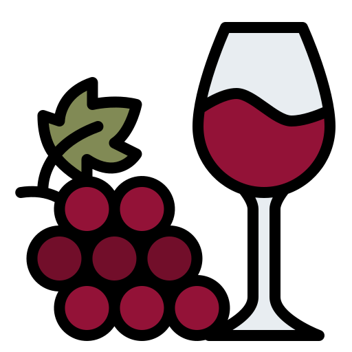
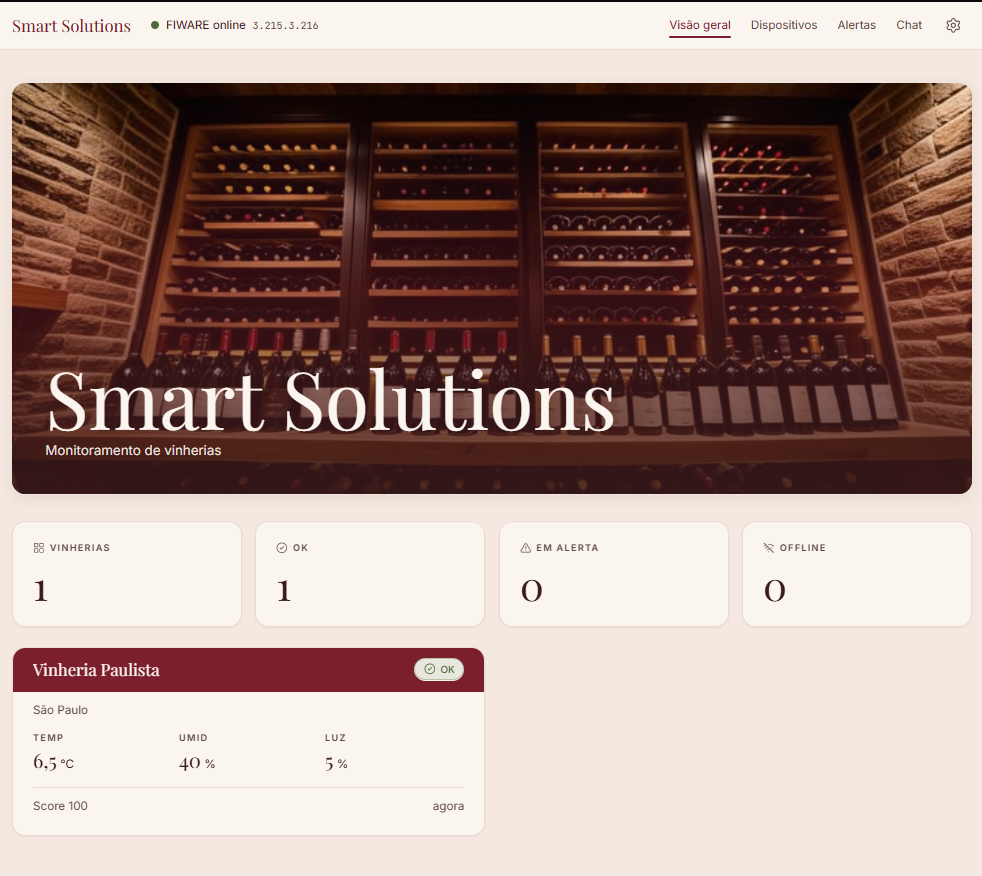
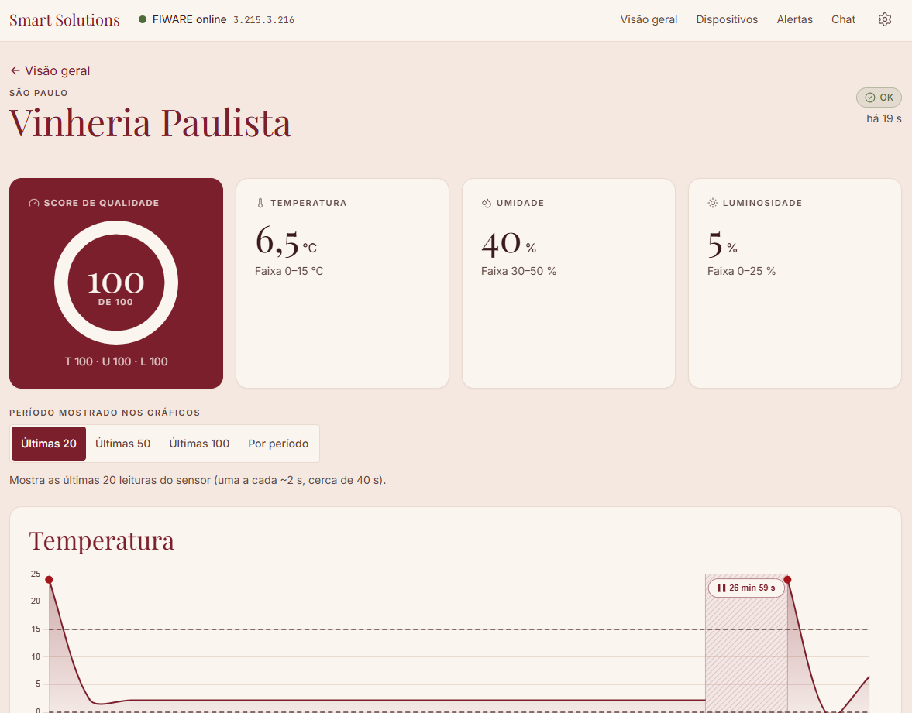
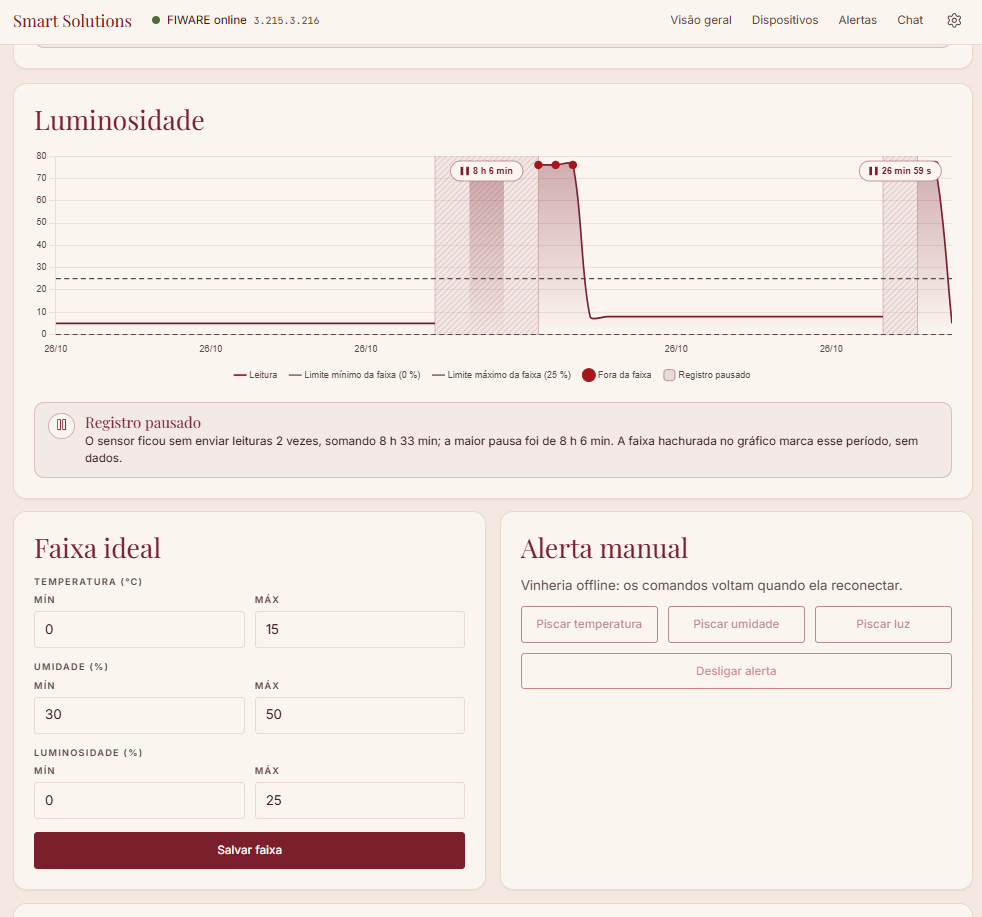
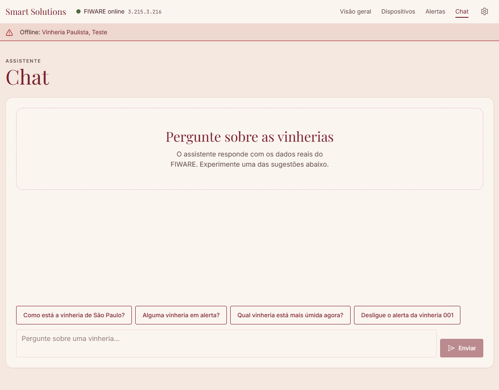
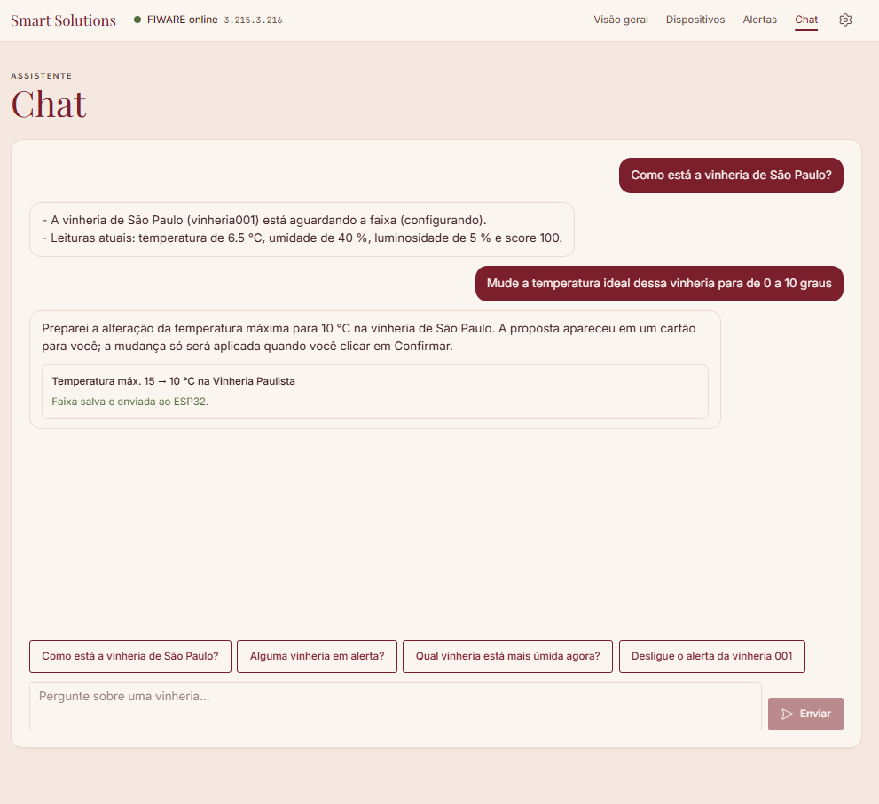
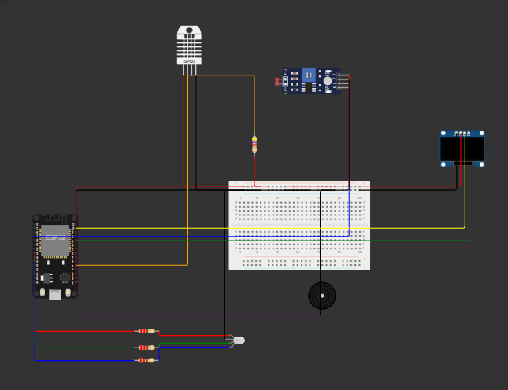

<a id="readme-top"></a>

<!-- Cores do painel: bordô #7A1F2B · vinho #3A1A1C · rosé #B5838D · verde ok #4F6B3A · creme #F4E8E0 -->

<div align="center">

  

  <h1>Smart Solutions</h1>
  <h3>Monitoramento inteligente de vinherias</h3>

  <p>
    Um ESP32 em cada adega, o FIWARE na nuvem e um painel único que mostra, avisa e responde.<br>
    Temperatura, umidade e luminosidade sob controle, em todas as lojas, o tempo todo.
  </p>

  <p>
    <a href="https://smart-solutions-vinheria.vercel.app"></a>
    <a href="https://wokwi.com/projects/476975851156685825"></a>
    <a href="docs/manual-software.md"></a>
  </p>

  <p>
    <a href="docs/arquitetura.md">Arquitetura</a>
    &middot;
    <a href="docs/manual-hardware.md">Manual de hardware</a>
    &middot;
    <a href="docs/roteiro-pitch.md">Roteiro do pitch</a>
    &middot;
    <a href="https://github.com/zackdevbr/Projeto-VinheriaFull/issues">Reportar problema</a>
  </p>

  <p>
    
    
    
  </p>

</div>

<br>

<!-- SUMÁRIO -->
<details>
  <summary><strong>Sumário</strong></summary>
  <ol>
    <li>
      <a href="#sobre-o-projeto">Sobre o projeto</a>
      <ul>
        <li><a href="#o-problema">O problema</a></li>
        <li><a href="#a-solução">A solução</a></li>
        <li><a href="#funcionalidades">Funcionalidades</a></li>
        <li><a href="#feito-com">Feito com</a></li>
      </ul>
    </li>
    <li><a href="#telas">Telas</a></li>
    <li><a href="#arquitetura">Arquitetura</a></li>
    <li>
      <a href="#detalhes-técnicos">Detalhes técnicos</a>
      <ul>
        <li><a href="#hardware">Hardware</a></li>
        <li><a href="#nomes-no-fiware">Nomes no FIWARE</a></li>
        <li><a href="#mqtt">MQTT</a></li>
        <li><a href="#padrões-de-alerta">Padrões de alerta</a></li>
        <li><a href="#regras-de-alerta">Regras de alerta</a></li>
        <li><a href="#api-do-backend">API do backend</a></li>
        <li><a href="#princípios-de-código">Princípios de código</a></li>
      </ul>
    </li>
    <li><a href="#como-rodar">Como rodar</a></li>
    <li><a href="#estrutura-do-repositório">Estrutura do repositório</a></li>
    <li><a href="#manuais">Manuais</a></li>
    <li><a href="#roadmap">Roadmap</a></li>
    <li><a href="#equipe">Equipe</a></li>
  </ol>
</details>

---

<!-- SOBRE -->
## Sobre o projeto

Solução IoT para monitorar o ambiente de uma rede de vinherias. Cada loja tem um ESP32 que mede temperatura, umidade e luminosidade, envia as leituras ao FIWARE na nuvem e avisa no local, com luz e som, quando algo sai da faixa ideal. Um painel web único mostra todas as vinherias, guarda o histórico, permite ajustar a faixa ideal de cada uma e responde perguntas em linguagem natural por meio de um chatbot.

Projeto do **Check Point 5** de Edge Computing & Computer Systems, FIAP, Prof. Dr. Fábio H. Cabrini. Entrega em 26/10/2026.

| Recurso | Link |
|---|---|
| Painel no ar | [smart-solutions-vinheria.vercel.app](https://smart-solutions-vinheria.vercel.app) (disponível enquanto o backend da equipe estiver ligado) |
| Simulação no Wokwi | [wokwi.com/projects/476975851156685825](https://wokwi.com/projects/476975851156685825) |
| Vídeo de apresentação | _em breve_ |
| Collection do Postman | [`postman/CP5-Vinheria.postman_collection.json`](postman/CP5-Vinheria.postman_collection.json) |
| Documento de produto (PRD) | [`PRD.md`](PRD.md) |
| Plano de implementação | [`PLANO-CP5-VINHERIA.md`](PLANO-CP5-VINHERIA.md) |

### O problema

Vinho é sensível ao ambiente. Temperatura alta acelera o envelhecimento e pode estragar a bebida; umidade baixa resseca a rolha e deixa o oxigênio entrar; luz em excesso degrada os aromas. Em uma rede com lojas em várias cidades, ninguém consegue vigiar cada adega o tempo todo, e um problema costuma ser percebido só quando o estoque já foi afetado.

### A solução

- **No local:** o ESP32 lê os sensores a cada 2 segundos, mostra os valores num display OLED e, quando recebe um alerta, pisca o LED RGB em vermelho e toca no buzzer um padrão de som diferente para cada problema (temperatura, umidade ou luminosidade). Assim, quem está na loja sabe o que aconteceu só pelo som.
- **Na nuvem:** o FIWARE recebe as leituras por MQTT, mantém o estado atual de cada vinheria e guarda o histórico.
- **No painel:** uma visão geral mostra todas as vinherias com status (ok, alerta ou offline). Para cada vinheria há gráficos históricos, score de qualidade do ambiente, ajuste da faixa ideal e linha do tempo de alertas. O backend compara cada leitura com a faixa e dispara o alerta remoto sozinho.
- **Chatbot:** responde perguntas como "como está a temperatura da vinheria de São Paulo?" ou "qual vinheria está mais úmida agora?" com os dados reais do histórico, e avisa por conta própria quando alguma vinheria está em alerta ou offline.

### Funcionalidades

- Cadastro de várias vinherias (ID, nome e cidade), com provisionamento automático no FIWARE e remoção completa.
- Visão geral da frota com status, valores atuais, score e tempo desde a última leitura.
- Gráficos históricos dinâmicos por atributo (últimos N pontos ou intervalo de datas).
- Faixa ideal configurável por vinheria: dispara os alertas, define o score e é enviada ao ESP32, que a mostra no OLED.
- Alerta remoto sonoro e visual, com padrão distinto por anomalia, disparado automaticamente ou pelo painel.
- Detecção de vinheria offline (sem leitura há mais de 30 s, configurável).
- Aviso global no painel (faixa fixa e notificações) quando uma vinheria entra em alerta, fica offline ou volta ao normal.
- Histórico de alertas com início, fim e duração.
- Score de qualidade do ambiente de 0 a 100.
- Chatbot com Google Gemini que responde por vinheria em linguagem natural.
- Animação de marca no boot do OLED (cacho de uva rolando para dentro da taça).
- LED RGB de status: verde (ok), amarelo (conectando ou sem faixa) e vermelho piscando (alerta).

### Feito com

**Firmware e hardware**

[](https://www.espressif.com/)
[](https://www.arduino.cc/)
[](https://mqtt.org/)
[](https://wokwi.com/)

**Middleware**

[](https://www.fiware.org/)
[](https://www.docker.com/)
[](https://aws.amazon.com/ec2/)
[](https://www.mongodb.com/)

**Backend**

[](https://www.python.org/)
[](https://fastapi.tiangolo.com/)
[](https://www.sqlite.org/)
[](https://pytest.org/)

**Painel e chatbot**

[](https://react.dev/)
[](https://vitejs.dev/)
[](https://tailwindcss.com/)
[](https://www.chartjs.org/)
[](https://ai.google.dev/)

Bibliotecas do firmware: `PubSubClient`, `DHT sensor library`, `Adafruit Unified Sensor`, `Adafruit GFX Library`, `Adafruit SSD1306`. Backend: `httpx`, `Pydantic`, `pandas`, `matplotlib`, `reportlab`, `respx`, `google-genai` (modelo `gemini-3.5-flash-lite`, com function calling). Painel: `react-router-dom`, `react-chartjs-2`. Ferramentas: Postman e Git/GitHub.

<p align="right">(<a href="#readme-top">voltar ao topo</a>)</p>

---

<!-- TELAS -->
## Telas

<div align="center">

**Visão geral:** todas as vinherias com status, valores atuais e score.



<br><br>

**Detalhe:** score de qualidade e gráficos históricos, faixa ideal, alerta manual e linha do tempo de alertas.


<br><br>


<br><br>

**Chat:** perguntas em linguagem natural sobre cada vinheria, com confirmação antes de alterar a faixa.


<br><br>


</div>

<p align="right">(<a href="#readme-top">voltar ao topo</a>)</p>

---

<!-- ARQUITETURA -->
## Arquitetura

A solução é organizada em sete camadas, do sensor à tela:

```
[1] Dispositivo (Edge)        ESP32 + DHT-11/22 + LDR + buzzer + LED RGB + OLED SSD1306
[2] Comunicação               Wi-Fi -> Mosquitto MQTT (1883), payload UltraLight 2.0
[3] Middleware IoT            IoT Agent MQTT (4041): UltraLight <-> NGSI-v2
[4] Contexto                  Orion Context Broker (1026) + MongoDB (27017)
[5] Persistência histórica    STH-Comet (8666)
[6] Aplicação                 Backend FastAPI + SQLite (triggers, alertas, score, chatbot)
[7] Apresentação              Painel React + Vite
```

As camadas 2 a 5 rodam em Docker numa instância AWS EC2 com IP elástico (stack [`fabiocabrini/fiware`](https://github.com/fabiocabrini/fiware)). O backend e o painel rodam localmente e se conectam à EC2.

**Fluxo de telemetria:** sensor → ESP32 → MQTT → IoT Agent → Orion → STH-Comet → backend → painel.
**Fluxo de comando:** painel/backend → Orion → IoT Agent → MQTT → ESP32 (LED e buzzer) → confirmação de volta ao Orion.

Diagramas detalhados em [`docs/arquitetura.md`](docs/arquitetura.md).

<p align="right">(<a href="#readme-top">voltar ao topo</a>)</p>

---

<!-- DETALHES TÉCNICOS -->
## Detalhes técnicos

### Hardware

<div align="center">
  
</div>

| Componente | Pino do ESP32 | Função |
|---|---|---|
| DHT-11 (DHT-22 no Wokwi) | GPIO 4 | Temperatura e umidade |
| LDR (divisor de tensão) | GPIO 34 (ADC) | Luminosidade, mapeada de 0 a 100 % |
| Buzzer | GPIO 5 | Alerta sonoro (tom de 4 kHz) |
| LED RGB | R 25 · G 26 · B 27 | Status: verde, amarelo ou vermelho piscando |
| OLED SSD1306 128x64 I2C | SDA 21 · SCL 22, endereço `0x3C` | Boot animado e carrossel de leituras |

O relógio do OLED vem de NTP (UTC−3). Cada instância do firmware é configurada num único bloco no topo do `.ino` (`CONFIGURAÇÃO DESTA INSTÂNCIA`): ID da vinheria, rede Wi-Fi, endereço do broker e modelo do DHT. Lista de materiais e montagem em [`docs/manual-hardware.md`](docs/manual-hardware.md).

### Nomes no FIWARE

| Item | Valor |
|---|---|
| Device | `vinheria00N` (ex.: `vinheria001`) |
| Entidade | `urn:ngsi-ld:Vinheria:00N`, type `Vinheria` |
| Headers | `fiware-service: smart` · `fiware-servicepath: /` |
| API key | `TEF` |
| Atributos | `t` → `temperature` · `h` → `humidity` · `l` → `luminosity` |
| Comandos | `blink_temp` · `blink_hum` · `blink_lux` · `alert_off` · `set_limits` |

### MQTT

| Tópico | Direção | Exemplo |
|---|---|---|
| `/TEF/<device_id>/attrs` | ESP32 → FIWARE | `t\|24.3\|h\|58\|l\|42` |
| `/TEF/<device_id>/cmd` | FIWARE → ESP32 | `vinheria001@blink_temp\|` |
| `/TEF/<device_id>/cmdexe` | ESP32 → FIWARE | `vinheria001@blink_temp\|ok` |

### Padrões de alerta

| Anomalia | Comando | LED RGB | Buzzer |
|---|---|---|---|
| Temperatura | `blink_temp` | vermelho piscando a cada 500 ms | 2 bipes curtos a cada 2 s |
| Umidade | `blink_hum` | vermelho piscando a cada 250 ms | 1 bipe longo a cada 3 s |
| Luminosidade | `blink_lux` | vermelho piscando a cada 125 ms | 3 bipes rápidos a cada 2 s |
| — | `alert_off` | volta ao verde | silêncio |

Os padrões rodam numa máquina de estado com `millis()`, sem `delay()`, então o ESP32 continua lendo e publicando enquanto alerta.

### Regras de alerta

O backend consulta o Orion a cada ciclo (uma chamada para a frota inteira) e compara cada leitura com a faixa ideal da vinheria:

- leitura sai da faixa → envia o comando do atributo uma única vez e abre o alerta;
- todas as leituras voltam à faixa → envia `alert_off` e fecha o alerta;
- vinheria sem leitura nova há mais de 30 s → fica offline, abre alerta `offline` e não recebe comandos até voltar.

A faixa padrão de uma vinheria nova é 12–18 °C, 50–70 % de umidade e luz de 0 a 30 %.

### API do backend

```
GET/PUT  /api/config                  configuração (IP do FIWARE, portas, intervalos)
GET      /api/config/health           saúde de Orion, IoT Agent e STH-Comet
GET      /api/fleet                   status de todas as vinherias
GET/POST /api/devices                 listar / cadastrar vinheria
DELETE   /api/devices/{id}            remover vinheria (local e FIWARE)
GET      /api/devices/{id}             detalhe da vinheria
GET      /api/devices/{id}/current    estado atual
GET      /api/devices/{id}/history    histórico (lastN ou intervalo de datas)
GET      /api/devices/{id}/score      score de qualidade
GET/PUT  /api/devices/{id}/triggers   faixa ideal
GET      /api/alerts                  histórico de alertas
POST     /api/devices/{id}/commands   comando de alerta (blink_*, alert_off)
POST     /api/chat                    chatbot
```

Documentação interativa (Swagger) em `http://localhost:8000/docs` com o backend rodando.

### Princípios de código

- Encapsulamento em camadas: rota → service → cliente FIWARE. Só `services/fiware_client.py` faz HTTP com o FIWARE; componentes React só usam `src/api/client.js`.
- Nenhum IP, porta ou chave fixos em código de lógica: tudo vem do `.env` ou da configuração salva. O IP do FIWARE pode ser trocado em runtime pelo painel.
- Código comentado em português.
- Segredos (como a chave do Gemini) só no `.env`, que não é versionado.

<p align="right">(<a href="#readme-top">voltar ao topo</a>)</p>

---

<!-- COMO RODAR -->
## Como rodar

O passo a passo completo está em [`docs/manual-software.md`](docs/manual-software.md). Resumo:

**1. FIWARE na EC2**

```bash
git clone https://github.com/fabiocabrini/fiware
cd fiware
docker-compose up -d
```

Liberar no Security Group as portas 1026, 4041, 8666 e 1883.

**2. Firmware**

Abrir o projeto no Wokwi (ou na Arduino IDE para o ESP32 físico), ajustar o bloco `CONFIGURAÇÃO DESTA INSTÂNCIA` com o ID da vinheria e o IP do broker, e iniciar a simulação.

**3. Backend**

```bash
cd backend
pip install -r requirements.txt
cp .env.example .env        # preencher FIWARE_HOST e GEMINI_API_KEY
uvicorn app.main:app --reload
pytest tests -v
```

**4. Front-end**

```bash
cd frontend
npm install
npm run dev                 # http://localhost:5173
```

**5. Cadastrar a vinheria** pelo painel, na página de dispositivos, com o mesmo ID usado no firmware.

<p align="right">(<a href="#readme-top">voltar ao topo</a>)</p>

---

<!-- ESTRUTURA -->
## Estrutura do repositório

```
projetovinheria/
├── README.md
├── PRD.md                  documento de produto
├── PLANO-CP5-VINHERIA.md   plano de implementação
├── CLAUDE.md               regras de trabalho do repositório
├── docs/                   arquitetura, manuais e imagens
├── firmware/               sketch do ESP32, animação de boot e projeto Wokwi
├── postman/                collections do FIWARE
├── backend/                API FastAPI
└── frontend/               painel React
```

---

<!-- MANUAIS -->
## Manuais

| Documento | Conteúdo | Status |
|---|---|---|
| [`docs/arquitetura.md`](docs/arquitetura.md) | Diagrama em camadas, fluxos de telemetria e de comando | pronto |
| [`docs/manual-hardware.md`](docs/manual-hardware.md) | Lista de materiais, pinagem, montagem, DHT-11 vs DHT-22 | pronto |
| [`docs/manual-software.md`](docs/manual-software.md) | EC2 e FIWARE, IP elástico, Postman, backend, front-end, rodar uma vinheria Wokwi em outro computador, troubleshooting | pronto |
| [`docs/roteiro-pitch.md`](docs/roteiro-pitch.md) | Roteiro de 5 a 7 minutos e checklist de preparação | pronto |

<p align="right">(<a href="#readme-top">voltar ao topo</a>)</p>

---

<!-- ROADMAP -->
## Roadmap

- [x] Firmware ESP32: sensores, publicação MQTT, alertas não bloqueantes, várias instâncias
- [x] Marca Smart Solutions e animação de boot no OLED
- [x] Documentação base: PRD, README e arquitetura
- [x] Backend: configuração e cliente FIWARE
- [x] Backend: cadastro de vinherias, histórico e score
- [x] Backend: motor de triggers, offline e log de alertas
- [x] Firmware: recebimento e exibição da faixa ideal
- [x] Painel: base, configuração e cadastro
- [x] Painel: visão geral, gráficos, triggers, alertas e score
- [x] Chatbot Gemini multi-vinheria
- [x] Manuais, collection final do Postman e roteiro do pitch
- [ ] Vídeo de apresentação

<p align="right">(<a href="#readme-top">voltar ao topo</a>)</p>

---

<!-- EQUIPE -->
## Equipe

**Smart Solutions**, FIAP, Check Point 5 de Edge Computing & Computer Systems, Prof. Dr. Fábio H. Cabrini.

| Nome | RM |
|---|---|
| Eduarda Soares Moraes | RM569369 |
| Isac Nilton Fernandes de Oliveira | RM573282 |
| João Benedito de Oliveira Simplício | RM570206 |
| Julia Souza Matarazzo | RM571340 |
| Mariana Malagutti Gomes Peixoto | RM570290 |

Repositório: [github.com/zackdevbr/Projeto-VinheriaFull](https://github.com/zackdevbr/Projeto-VinheriaFull)

<p align="right">(<a href="#readme-top">voltar ao topo</a>)</p>
